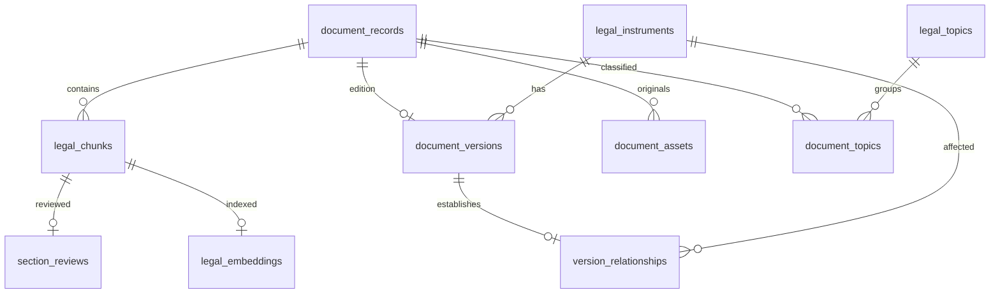

# Legal library data and deployment

The application still uses SQLite. The new relational catalog is implemented and migrated locally; it does not switch the runtime to Supabase/PostgreSQL. Database size alone is not a production-readiness measure. At larger traffic volumes or with multiple application replicas, implement and validate a PostgreSQL repository before switching. The old partial Supabase export refuses to run against the upgraded catalog so it cannot silently omit edition history.

## Data model

All application SQLite connections enable foreign keys and a busy timeout. Existing section IDs and original review text survive migration. Legacy metadata, proposed text-detected relationships and audit tables are retained for compatibility. Text-detected relationships remain proposals; reviewed edition relationships use real instrument references.

## Existing library migration

`python -m scripts.maintain_library` audits without changing the library. `--apply` first creates a SQLite backup, adds the relational catalog, rebuilds derived full-text search, archives metadata with no sections as JSON records inside `archived_metadata`, and copies registered PDF originals to hashed storage. No source document or legal date is invented or deleted. The report records missing originals and before/after integrity checks. Archived metadata remains available for recovering/re-importing the larger source collection; it is not public legal evidence.

`python -m scripts.cleanup_generated --apply` removes only named old test caches and archives the optional legacy JSON chunk export. Other files under `tmp`, scanned collections, legal PDFs, and source documents are retained. Text chunks inside SQLite are required for search and citations.

`python -m scripts.relocate_data --destination D:/legal-app-data --update-config` copies the database using SQLite's backup API, verifies all referenced original hashes, and updates only the two data-path entries in `.env`. It refuses to overwrite an existing destination database. Old copies are retained for rollback. Stop writes during relocation and restart every application process afterwards. Environment variables supplied by a service manager override `.env` and must also be updated there.

The local migration used `D:/legal-app-data/legal_index.sqlite3` and `D:/legal-app-data/originals`. For hosting, these paths must be mapped to durable private volumes; they are not automatically uploaded to a cloud service. Back up the database and originals together and exercise restore procedures before launch.

## Adding a new year or amendment

1. Upload a distinctly named original. A name already registered cannot overwrite a previous edition. Original bytes are stored by SHA-256; all scanned image pages are retained and individually addressable.
2. In **Document details**, enter the official URL, publication date and effective date after checking the source. Enter the stable law ID, edition year, edition kind, and the period to which this text applies. Do not substitute the certification date for a commencement date without checking.
3. Complete editions of the same law use the same law ID. Effective periods are half-open: `valid_from <= requested_date < valid_to`. A blank end date means no reviewed end date has been recorded. Overlapping complete editions are rejected.
4. To replace a complete edition, first record the previous edition's end date and reapprove it for historical lookup. Create the new consolidated edition starting on that date and link it with **Replaces complete edition**. Keep the old edition published with its end date; using the legacy **Superseded** status withdraws it from every search, including historical searches.
5. An amendment has its own instrument ID and links to the affected law with **Amends** or **Repeals**, supported by the relevant provision. It cannot replace a complete law. Relationships do not automatically rewrite sections or prove a text is the currently consolidated law.
6. Verify every extracted section and confirm both review attestations before publishing. Any edit withdraws the document. Rebuild embeddings after corrections or imports.

Year and effective period appear beside source citations. Search, chat, and clarification preparation accept an ISO `as_of` date; the web form exposes the same option. Historical searches exclude undated legacy sources. Default development searches may include published legacy material, clearly labelled with unverified year/period. Production excludes undated legacy editions.

## Production configuration

Use `ENVIRONMENT=production`, a random `ADMIN_SESSION_SECRET` of at least 32 characters, and a unique `ADMIN_PASSWORD` of at least 16 characters. Absolute database and storage paths outside the code checkout are mandatory. Production startup rejects insecure defaults, and the admin cookie requires HTTPS. Configure HTTPS, private-volume permissions, request limits, monitoring, backups, and an appropriate authenticated reviewer workflow in the hosting environment.

Production publishing also requires the source URL, valid publication/effective dates, a reviewed edition record, and an affected-law link for amendments. Existing published sources without edition metadata are excluded from production retrieval. Human verification of legal currency is still required: software does not establish the legal effect of an amendment.

The taxonomy was seeded from the supplied handwritten topic list. The court diagrams and case-code screenshots were treated as reference material, not ingested as verified current law. Source verification is required before adding jurisdiction rules, monetary thresholds, or procedural guidance.

## Validation

Automated tests exercise foreign keys, preserving reviews during legacy migration, effective-date boundaries in keyword and semantic search, rejection of overlapping complete editions, amendment targets, atomic rollback, re-import withdrawal, storage path traversal, checksummed relocation, insecure production settings, and prevention of whole-library reset. Existing API and publication tests also run. These tests do not certify the corpus or verify an external PostgreSQL deployment.

## Legacy folder intake

`python -m scripts.migrate_collections --apply` inventories every PDF in the four legacy collections, checks SHA-256 against current registered originals, archives the complete source tree under the data directory's `source-collections`, and registers each path in `collection_files`. Exact duplicates share a canonical document, while every input path remains inventoried. Extracted pages retain real PDF page numbers and stay in review. PDFs with no extracted text are visible in the admin workspace and their original PDF remains accessible.

`--apply --ocr --workers 8` recovers missing text pages locally using Sinhala and English Tesseract. Successful page text is cached outside the source checkout, so the process can resume. Blank or unreadable pages are reported, and OCR text requires human review. No Gemini call is needed.

`--apply --remove-source-folders` rechecks the complete inventory, database integrity, archive hashes and managed-original links before removing only the four named folders from the checkout. If a source has changed or a copy is missing, removal stops. `--verify` checks the externally archived collection after removal and writes the final verification report. There is no need to re-upload files already registered by this process.
